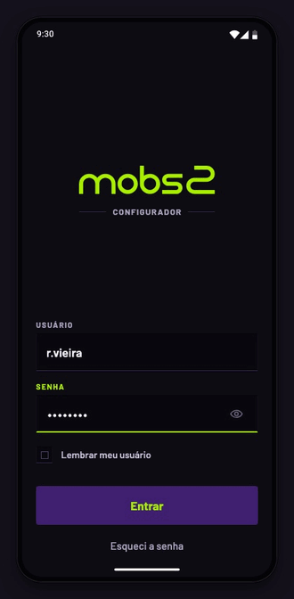

# Mobs2 Configurador · Protótipo

Aplicativo mobile de instalação, configuração e homologação de módulos de telemetria embarcados, usado pelo técnico de campo. Este repositório reúne o design do produto, o design system e o protótipo navegável construído a partir deles.

> **Isto é um protótipo, não o produto.** O app daqui roda no navegador, com dados de exemplo e sem módulo, servidor ou Bluetooth de verdade. Ele serve de referência pra construir o produto: o comportamento, os textos e o desenho de cada tela.
>
> Propriedade da **MOBS2 COMERCIO E SERVICOS LTDA - EPP**. Conteúdo para consulta: usar, copiar ou distribuir depende de autorização por escrito. Veja [Propriedade e uso](#propriedade-e-uso).

<p align="center">
  
</p>

<p align="center"><b><a href="https://configurador-mobs2-prototipo.vercel.app">Abrir o protótipo →</a></b></p>

## O problema

O técnico de campo é terceirizado e não conhece a lógica de programação do módulo. Ele instala em pátio, obra e zona rural, muitas vezes sem rede, às vezes embaixo do ônibus. E o equipamento não avisa quando algo dá errado. **Sucesso de comando não é sucesso de configuração**: um bloco pode ser aceito e não funcionar, e um erro de faixa apaga em silêncio e só aparece dias depois. O checklist antigo era uma lista de 30 itens marcáveis à mão, com um "marcar todos" que permitia homologar sem verificar.

A resposta do produto: **o sistema decide e o técnico executa**, todo envio é confirmado por releitura do módulo, e **a evidência é gerada pelo app, não digitada pelo técnico**.

## O que o app faz

O app conduz a instalação em sequência e prova cada passo:

1. **Sincroniza** o pacote da unidade (os ônibus, as conexões, os modelos, os eventos e as cercas) pra trabalhar mesmo sem rede.
2. **Conecta** ao módulo sem fio, por Bluetooth: pareia na primeira vez e reconecta sozinho quando a conexão cai.
3. **Diagnostica** o módulo: serial, firmware, alimentação contra a faixa do modelo, a antena do GPS, entradas, modem, SIM e o número do chip, e as mensagens que o módulo ainda guarda. Serial fora do cadastro, modelo sem suporte ou firmware fora da lista travam a instalação ali.
4. **Vincula** o módulo ao ônibus, confirmado pela placa, frota, fabricante e modelo.
5. **Grava a configuração** em seis blocos, na ordem do script, e confere cada um no módulo. Na manutenção, reenvia um bloco por vez e avisa o que depende dele.
6. **Calibra** só o que o veículo não entrega pela CAN: o ônibus não calibra nada, e o caminhão coletor calibra o hodômetro e a rotação, com a velocidade e o horímetro opcionais.
7. **Roda o ciclo de testes** com o ônibus parado: ignição ligada, rotação, cartão do motorista e ignição desligada, cada um só quando se aplica. A cada passo, o app diz o que o técnico tem que fazer, e o técnico confere o cartão lido com o número impresso.
8. **Fecha o checklist**: o app confere sozinho o que consegue, e o técnico fotografa o resto e testa o bip do leitor. Ao encerrar, o módulo reinicia, o autoteste confere a instalação, e só aí ela é homologada.

Antes de tudo, o login: o técnico recupera o acesso sem ligar pra ninguém. O app nunca revela se uma conta existe; o técnico digita o telefone ou o e-mail, e a resposta é sempre a mesma.

As telas traduzem as ações em perguntas de negócio, e o app fala com o módulo. A APN é a única exceção: um dado técnico que aparece na tela porque o técnico precisa conferi-lo.

## O protótipo

O protótipo roda no navegador e anda só por toque, do login ao encerramento. No computador, o celular aparece em tamanho real dentro de um palco:

- o quadrado no canto abre o painel com as 15 telas;
- a coluna **Estados desta tela** oferece os exemplos parados (erros, manutenção, calibração do caminhão e outras condições), montados pelos dados de exemplo. O toque não avança esses quadros; **Voltar ao fluxo** devolve o percurso guardado. O painel abre o contexto normal de cada tela;
- cada tela, momento e estado tem um link próprio (`?tela=T07&estado=02-estado-serial-nao-cadastrado`).

No celular, o app ocupa a tela inteira.

## Como foi construído

Cada tela, momento e estado tem uma referência desenhada, em HTML e PNG, 201 ao todo. O protótipo foi construído contra elas e comparado pixel a pixel; toda diferença que sobrou tem um nome e um motivo registrados.

O comportamento vem da ficha de cada tela, os textos do `textos.md` dela e as medidas dos tokens. O repositório contém 51 roteiros de navegação e uma checagem que confere os dados de exemplo e as fichas das telas contra as referências.

**As tecnologias:** o protótipo é um app web em **React 18** com **Vite**, em JavaScript, sem biblioteca de componentes de fora: as peças são as do design system, construídas no próprio projeto, com os valores dos tokens em CSS. Os ícones são o jogo de 41 SVGs do design system, e a fonte é a **Barlow**. A comparação com as referências roda no **Chrome** sem tela, com o **pixelmatch** medindo a diferença pixel a pixel. Ele é publicado na **Vercel**.

| telas | momentos | estados | referências | folhas do design system | temas | histórias de usuário | casos de dados | decisões registradas |
|---|---|---|---|---|---|---|---|---|
| 15 | 104 | 82 | 201 | 10 | 2 | 109 | 63 | 54 |

## O repositório

```
01-produto/          por que existe, pra quem, as regras de negócio, as histórias e os fluxos
02-telas/            uma pasta por tela: ficha, estados, animação, textos e as referências
03-design-system/    tokens (os dois temas), leis, movimento, componentes, os ícones e as dez folhas
04-dados/            os dados de exemplo (o contrato de dados) e a checagem que os confere
05-recursos/         a marca, a fonte e os desenhos do sistema
06-prototipo/        o protótipo navegável, o palco e as ferramentas de verificação
07-decisoes/         o porquê de cada escolha, com o que foi descartado
08-para-o-dev/       por onde começar a construir o produto
```

A ordem de leitura de cada perfil está no [`LEIA-PRIMEIRO.md`](LEIA-PRIMEIRO.md), e o histórico de mudanças no [`CHANGELOG.md`](CHANGELOG.md). Quem vai desenvolver o produto começa pelo [guia do dev](08-para-o-dev/README.md): o contrato de dados, as integrações com o módulo e o servidor, os testes e as decisões que ainda precisam de definição. O protótipo simula os equipamentos e serviços; transporte, autenticação, persistência sem rede e captura de evidências precisam ser implementados no produto.

## Rodar localmente

```bash
cd 06-prototipo/app
npm install
npm run dev
```

Abre em `http://localhost:5173`. Na mesma pasta, rode `npm run checar` para conferir o mock e as regras locais, e `npm run build` para gerar o build.

Os testes de navegação e a comparação visual estão no [guia de testes do dev](08-para-o-dev/testes-prontos.md).

## Propriedade e uso

**Este repositório é propriedade da MOBS2 COMERCIO E SERVICOS LTDA - EPP**, CNPJ 10.938.384/0001-41. © 2026. Todos os direitos reservados.

**O que é da empresa:** tudo o que está aqui, ou seja, o produto e as regras de negócio, o design das telas, o design system, os textos, as referências desenhadas, os dados de exemplo e o código do protótipo.

**O que é permitido:** abrir, ler e navegar pelo conteúdo e pelo protótipo publicado, para consulta.

**O que depende de autorização prévia e por escrito da empresa:**
- copiar ou reproduzir qualquer parte, no todo ou em parte;
- usar o conteúdo em outro produto, projeto ou trabalho;
- modificar, publicar, distribuir ou repassar a terceiros.

Estar visível não significa estar liberado para uso. Os termos completos estão no [`LICENSE`](LICENSE).

**O que é de terceiros** segue a licença de cada um, e não é da empresa:
- as fontes **Barlow** e o recorte da **Google Sans**, sob a SIL Open Font License 1.1, com o texto da licença em [`05-recursos/fontes/`](05-recursos/fontes/);
- os desenhos de oito ícones que vêm do **Lucide** (quatro do app e os quatro do palco), sob a licença ISC;
- as barras do sistema, do kit do **Material 3**, do Google.

**Autoria:** design de produto e protótipo por [Luiz Felipe Silva Correia](https://www.linkedin.com/in/lfelipe-scorreia/), para a MOBS2.
